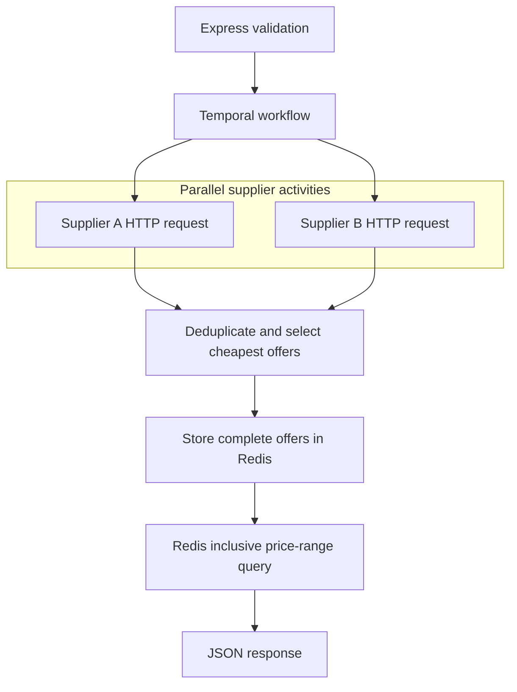

# Hotel Offer Orchestrator

Compare offers from two mock hotel suppliers and return the cheapest offer for each hotel, with optional price filtering. Built with Node.js 22 LTS, strict TypeScript, Express, Temporal, Redis, and Docker Compose.

**Live API:** [hotelapi.nishantraj.me](https://hotelapi.nishantraj.me) · [Health](https://hotelapi.nishantraj.me/health)

## Features

- Call both suppliers in parallel through Temporal activities.
- Select the cheapest offer per hotel; Supplier A wins equal-price ties.
- Deduplicate hotel names after trimming whitespace and ignoring case, retaining supplier-exclusive hotels.
- Save all selected offers in Redis before applying inclusive price bounds with `ZRANGEBYSCORE`. Each workflow has an isolated key and retry-safe writes.
- Report API, worker, Temporal, Redis, and both suppliers through `/health`.

## Request flow



## Local setup

Install Git and Docker Engine with Compose v2 (`--wait` support) and Linux containers. On Windows, use Docker Desktop with WSL 2. Keep ports **4000**, **6379**, and **7233** available; internet access is needed for image and package downloads.

```sh
git clone https://github.com/nishantnsut27/hotel-offer-orchestrator.git
cd hotel-offer-orchestrator
docker compose --profile local up --build --wait
curl --fail "http://localhost:4000/api/hotels?city=delhi&minPrice=5000&maxPrice=6000"
```

No `.env` or host Node.js installation is needed. Compose starts separate API, worker, Temporal, and Redis containers. In PowerShell, use `curl.exe` for curl and `npm.cmd` for npm commands.

To shut down:

```sh
docker compose --profile local down
```

Demo data is ephemeral: Redis offers expire after five minutes, and Redis contents and Temporal development-server history are lost when their containers are recreated.

## API

| Method | Endpoint            | Description                                                                  |
| ------ | ------------------- | ---------------------------------------------------------------------------- |
| GET    | `/api/hotels`       | Cheapest offers, sorted by price then name; requires `city`.                 |
| GET    | `/supplierA/hotels` | Supplier A fixtures; optional `city` filter, otherwise all hotels.           |
| GET    | `/supplierB/hotels` | Supplier B fixtures; optional `city` filter, otherwise all hotels.           |
| GET    | `/health`           | Component and supplier health; HTTP 200 when all are up, otherwise HTTP 503. |

Hotel search accepts three query parameters:

| Parameter  | Required | Description                                                       |
| ---------- | -------- | ----------------------------------------------------------------- |
| `city`     | Yes      | Trimmed and lowercased; demo fixtures cover `delhi` and `mumbai`. |
| `minPrice` | No       | Inclusive minimum price in INR; finite and non-negative.          |
| `maxPrice` | No       | Inclusive maximum price in INR; finite and non-negative.          |

Omitted price bounds are open. Invalid or repeated parameters and `minPrice > maxPrice` return HTTP 400. Unknown cities and empty ranges return HTTP 200 with `[]`. Supplier or infrastructure failures return HTTP 503; search deadlines return HTTP 504. Commission does not affect price ranking.

The sample request above returns the assessment's example response:

```json
[
  { "name": "Holtin", "price": 5340, "supplier": "Supplier B", "commissionPct": 20 },
  { "name": "Radison", "price": 5900, "supplier": "Supplier A", "commissionPct": 13 }
]
```

## Testing

Import the [Postman collection](postman/hotel-offer-orchestrator.postman_collection.json) and run all 75 requests. Set `supplierDown=none` for the normal deployment and the request timeout to **40000 ms**.

| Target | `baseUrl`                        |
| ------ | -------------------------------- |
| Local  | `http://localhost:4000`          |
| Live   | `https://hotelapi.nishantraj.me` |

For clean-checkout verification, install Node.js **22.13 or newer within 22.x**, then run these commands with the local Docker stack running. The CLI validates the collection schema before executing it.

```sh
npm ci
npm run lint
npm run format:check
npm run typecheck
npm run build
npm run test:postman
```

To test the live API from the CLI:

```sh
npm run test:postman -- --env-var baseUrl=https://hotelapi.nishantraj.me
```

## Deployment

Use an x86-64 Ubuntu EC2 instance with Git, [Docker Engine](https://docs.docker.com/engine/install/ubuntu/), and Compose **2.24.4 or newer**. Allow inbound TCP **80** and **443**, restrict SSH to your IP, and leave Redis and Temporal ports private.

Point your hostname's DNS **A record** to the instance's public IPv4 address. On the instance, clone the repository using the commands above and add the hostname to a private `.env` in the checkout:

```dotenv
PUBLIC_HOSTNAME=hotelapi.nishantraj.me
```

Start the HTTPS deployment using both Compose files:

```sh
sudo docker compose -f compose.ec2.yaml -f compose.ec2.https.yaml up --build --wait --wait-timeout 180
curl --fail https://hotelapi.nishantraj.me/health
```

Replace the example hostname with your own in `.env` and the health check. The deployment runs API, worker, and Temporal in one demo container with private Redis. Caddy provisions and renews HTTPS certificates and redirects HTTP to HTTPS. Use both Compose files for later updates and shutdown; retain the Caddy certificate volumes. Update DNS if the instance's public IP changes.
